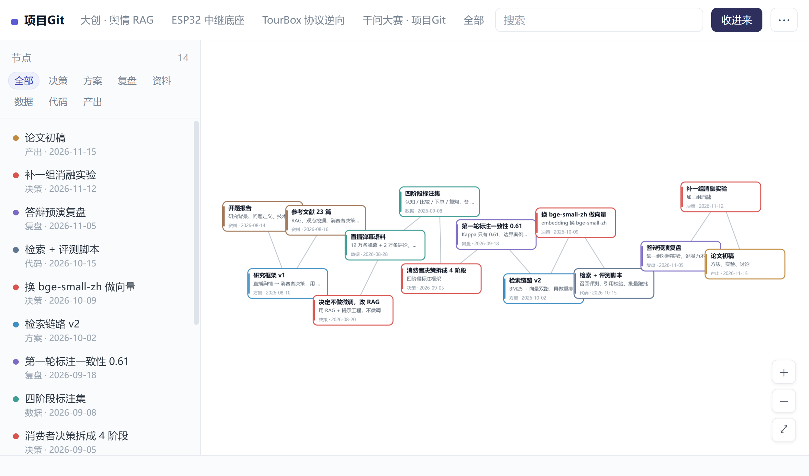

# 项目Git · 团队知识的时间轴

> 代码有 git，项目也该有。

一个**桌面应用**（Electron）：把群聊、纪要、文档里散落的决定、方案、复盘，自动判断归属挂到项目图上；
一句话搜索，镜头推过去，看见它从哪来、又被谁取代。



## 演示数据用的是你真实做过的项目

不是编的案例，是这台机器上跑过的四个项目：

| 项目 | 图上有多少节点 | 里面有什么 |
|---|---|---|
| **大创 · 舆情 RAG** | 9 | 定框架、决定不微调、标注一致性 0.61 的复盘、答辩预演后的补救 |
| **ESP32 中继底座** | 11 | 先走 HID 流 → 放弃改 GATT（红箭头=取代）、productKey 冒充、基线锁 b6677ef、暂停归档 |
| **TourBox 协议逆向** | 8 | CDC-ACM 抓包、Console 独占 COM3、逆向 LibH.dll、放弃脱壳 |
| **千问大赛 · 项目Git** | 6 | 选题、放弃 03、第一版推倒重来、改力导向 |

其中 7 个节点的“出处”直接指向真实文件（`中继底座-试错记录.md`、`TourBox-协议.md` 等），
点「打开文件」会用系统默认程序打开整份原文。

## 运行

```bash
cd desktop
npm start
```

桌面上的 **项目Git** 快捷方式也能直接开。

## 界面

| 区域 | 作用 |
|---|---|
| 顶栏 | 项目切换 · 搜索 · 收进来 · ⋯（待归类 / 调整节点 / 新建类型 / 接入 git） |
| 左栏 | 当前项目的节点清单，按类型筛（决策/方案/复盘/资产），点一条就飞过去 |
| 画布 | 关系图谱：圆点=节点，颜色=类型，直线=关系，红线=取代；**日期写在节点下面** |
| 右栏 | 浮在画布上的卡片，不挤压画面。出处 / 字段 / 关联 / 删除 / 改类型 |
| 底栏 | 当前操作反馈 |

交互：拖动节点（松手才判定，拖动不会误开面板）· 滚轮缩放 · 双击聚焦 · `/` 搜索 · `F` 适应窗口 · `E` 调整 · `Ctrl+Z` 撤销。

## 它怎么工作

```
输入（粘贴）
   ↓ 切条：说话人 + 时间 → 独立条目
   ↓ 判定：类型（线索词）+ 项目（关键词）+ 挂到哪个节点（相似度/时间邻近/类型）
   ↓ 闸门：拿得准 → 直接挂；不够准 → 弹窗问“这条属于哪里？”；拿不准 → 先放着，不丢
   ↓ 落到图上：节点 + 关系（属于 / 取代 / 相关 / 证据）
```

- **取代**是红色箭头，旧节点变灰但不删除
- **每个有原文的节点都能回溯**：文件名 + 页码或字符区间，点「打开文件」直接打开整份文件
- **调整**：把一个节点拖到另一个节点上，就挂到它下面

## 技术

| 层 | 选择 |
|---|---|
| 外壳 | Electron 45：真窗口、原生菜单、数据与判定都在主进程 |
| 图形 | Canvas + **d3-force**（力导向，纯 JS 计算，不用绝对时间轴） |
| 数据 | 本地 `data/state.json`，原子写；菜单可重置 |
| 判定 | `engine.js` 纯函数，可在 Node 里单测 |
| 打开原文 | 直接交给系统默认程序（`shell.openPath`） |

```
desktop/
  main.js       主进程：窗口、菜单、IPC、数据与判定、git 只读
  preload.js    安全桥（contextIsolation）
  engine.js     切条 / 判定 / 检索
  store.js      状态读写、撤销栈
  web/          渲染层（index.html / style.css / app.js / vendor/d3.min.js）
  seed/         演示数据
tools/seed_real.py   生成演示数据（从真实项目文档里取片段、算好位置）
data/           当前数据与原文
```

## 已知边界

- 单用户、无权限体系
- git 只读单仓库（默认读 `D:\03_code_list\esp32s3-relay-dock`）
- 图片输入：结构已就位，多模态调用尚未接线
