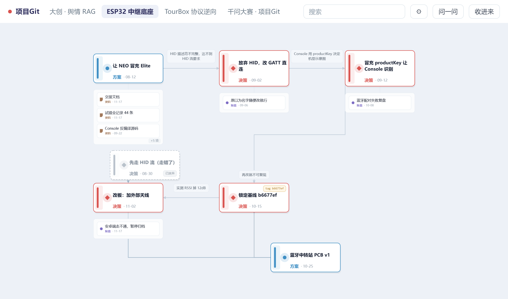

# 项目Git · 团队知识的时间轴

> 代码有 git，项目也该有。

一个**桌面应用**（Electron）：把群聊、纪要、文档里散落的决定、方案、复盘，整理成一张 **Git 式提交图**——
主干是决策链，分叉是一次尝试，终止的尝试留在图上（带 ×），被采纳的汇回主干，里程碑是一面小旗，材料挂在提交下面。
再配一个「问一问」：问它为什么这么定、后来怎么样了、原文在哪，答案带字符级引用。



## 现在能做什么

| 能力 | 说明 |
|---|---|
| **看** | 卡片式提交图：主干 / 分支 / 终止 × / 合并 / tag / 材料卡；折行排版，一屏装得下 |
| **问** | 「问一问」：5 个工具 + Agent 循环；答案给结论、依据、走过的岔路、原文区间 |
| **看原文** | 详情里出处可点：Markdown 渲染并高亮命中句；PDF 用独立窗口翻页并框出命中处 |
| **导** | 一个 JSON 批量导入（`tools/ingest.js`），自动归一类型/状态/日期、去重、补边、备份 |
| **收** | 顶栏「收进来」：粘一段群聊，切条 → 判定归属 → 落图 |
| **配** | ⚙ 设置：模型地址 / 模型名 / API Key；没配就走本地规划器（离线可用） |

## 演示数据用的是真实项目

| 项目 | 节点 | 里面有什么 |
|---|---|---|
| **北极星 · 客服工单分流** | 12 | 规则分流 → 分类模型 → 知识库草稿；含一条**放弃的微调路线**、tag v0.9 |
| **山海 · 边缘告警** | 11 | 现场样本、回传方案对比、本地缓存、交付清单；含一条**放弃的 WiFi 回传**、tag v1.0 |
| **潮汐 · 内容审核台** | 9 | 误判分析、复核流程、灰度报告；tag v0.5 |

**21 个资料/数据/代码条目，21 份真实原文**，全部能点开、能定位到字符区间（`tools/check_sources.py` 可自检）。

## 运行

```bash
cd desktop
npm start
```

桌面上的 **项目Git** 快捷方式也能直接开。

## 三条常用流程

**① 问一个问题**

```
顶栏「问一问」→ 为什么放弃 HID？现在还有效吗？
→ 结论：放弃 HID，改 GATT 直连（有效 · 09-02）
  依据：HID 描述符不完整
  之前：先走 HID 流（已放弃）
  引用：中继底座-试错记录.md · 第 287–306 字  [点开]
```

**② 导入一个项目（给 Agent 用）**

```bash
node tools/ingest.js examples/batch-example.json --dry-run   # 先看统计
node tools/ingest.js examples/batch-example.json            # 正式导入
```

契约见 `docs/INGEST.md`；给 Agent 的 skill 在 `skills/project-git-ingest/SKILL.md`。

**③ 接入模型**

⚙ 设置里填 `https://api.deepseek.com/v1` / `deepseek-chat` / `sk-...`；也可写 `data/qa_config.json` 或环境变量 `PG_QA_API_KEY`。
Key 无效或断网时自动回落本地规划器，不影响使用。

## 评估（可复跑）

```bash
node tools/eval_qa.js     # 20 题简单问法（含标题词）→ 本地 17/20
node tools/eval_hard.js   # 20 题全部换说法        → 本地 10/20
```

难问法分类：事实 3/6、状态 4/6、跨项目 1/5、溯源 2/3。
**状态类靠结构化字段就能扛住换说法，事实与溯源需要模型多跳**——这正是接模型的意义。

## 自检（每次改完跑一遍）

```bash
python tools/check_sources.py   # 每个资料/数据/代码条目都有真实原文、偏移对得上
node tools/check_layout.js      # 4 个项目的布局：卡片/材料/行距/材料框越界，0 重叠
node tools/eval_qa.js           # 简单问法
node tools/eval_hard.js         # 换说法
```

## 技术

| 层 | 选择 |
|---|---|
| 外壳 | Electron 45：真窗口、原生菜单、无服务器、无端口 |
| 图形 | Canvas 自绘卡片；布局是确定性计算（折行 + 蛇形 + 泳道），不依赖力导向 |
| 数据 | `data/state.json`（原子写 + 导入前备份）；材料在 `data/files/` |
| 问答 | `qa.js`：5 个工具 + 工具调用循环；无 key 时本地确定性规划器 |
| 导入 | `ingest.js`：归一化 + 去重 + 自动补边；CLI 与 IPC 共用 |

```
desktop/
  main.js       主进程：窗口、菜单、IPC、PDF 子窗口、文件定位
  preload.js    白名单桥（window.api）
  engine.js     切条 / 判定 / 检索
  store.js      状态读写、撤销栈
  qa.js         工具层 + Agent 循环 + 本地规划器
  ingest.js     批量导入（标准化）
  web/          index.html / style.css / app.js / pdf.html / pdf.js / vendor/
  seed/         演示数据
data/           state.json + files/（21 份原文）+ qa_config.json（不进 git）
tools/          seed_real.py · check_sources.py · ingest.js · eval_qa.js · eval_hard.js · 设计稿生成
docs/           设计稿、设计图、截图、INGEST 契约
skills/         给使用者 Agent 的 skill
```

## 已知边界

- 单用户、无权限体系
- 收进来目前是「粘文本」；文件批量导入走 ingest
- git 只读：仓库路径在设置里自己填，默认不连任何仓库
- 模型 key 需要自己配；配错会自动降级，不会卡住

## 许可

MIT（见 `LICENSE`）。演示数据为合成内容，与任何真实项目无关。

## 目录结构

```
desktop/        应用本体（主进程 / preload / 引擎 / 渲染层 / PDF 查看页）
desktop/seed/   演示数据（首次启动会复制到 data/）
docs/           设计稿、使用说明、契约、截图
skills/         给使用者 Agent 的 skill
tools/          生成演示数据、自检、评估、批量导入 CLI
examples/       可导入的示例批次
```
