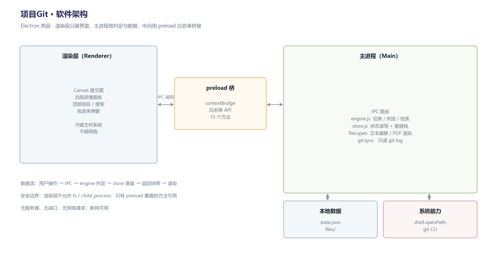
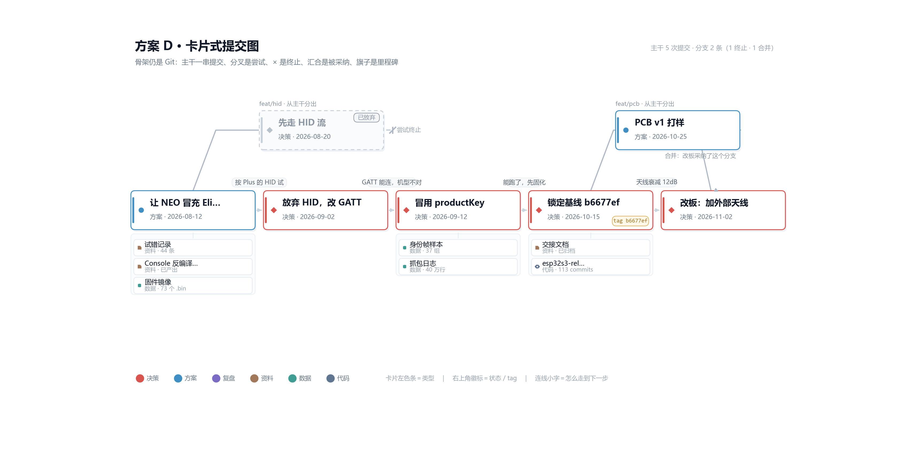
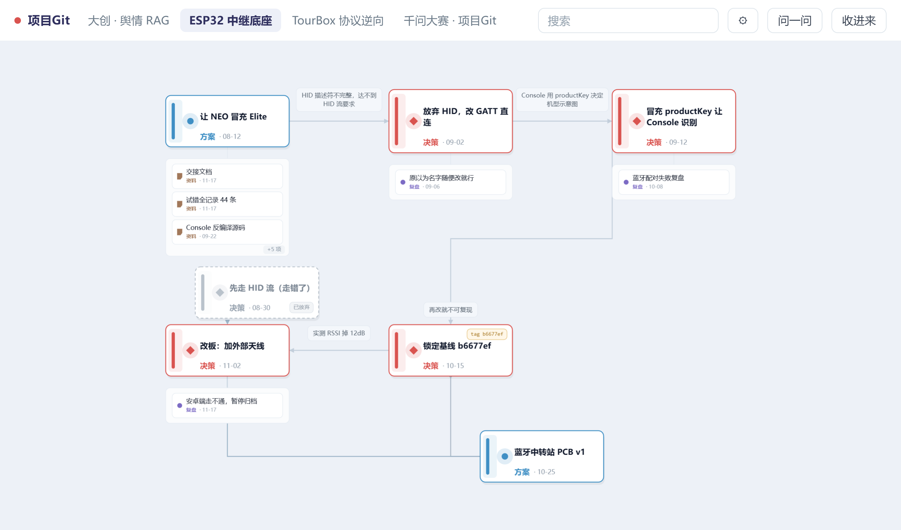
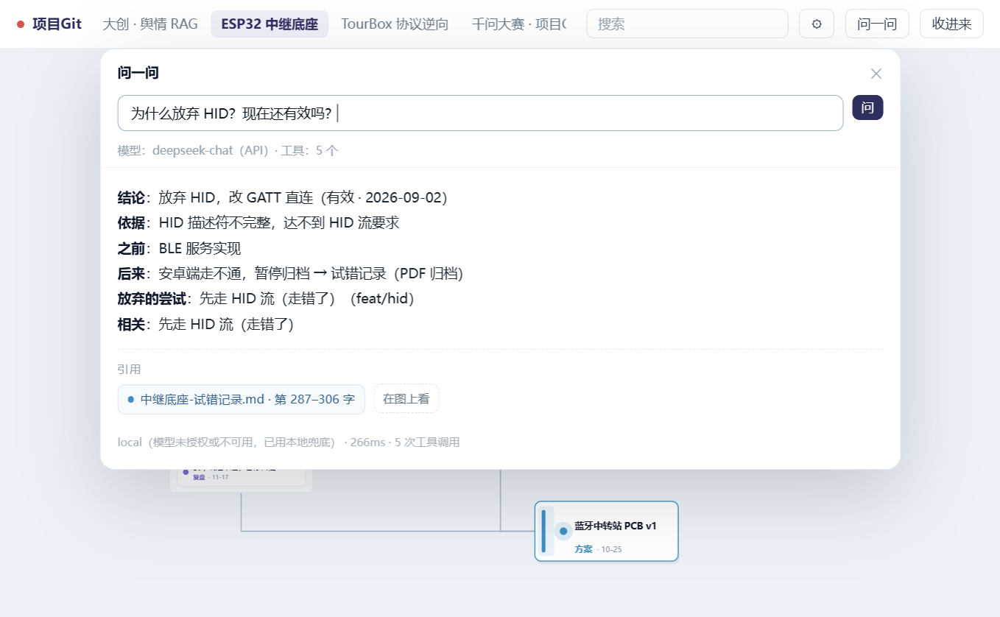
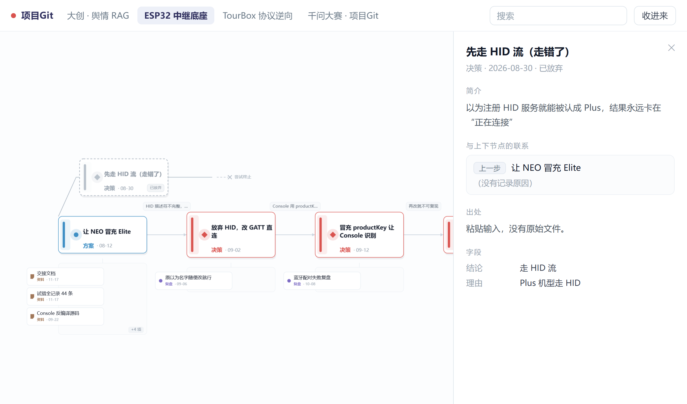
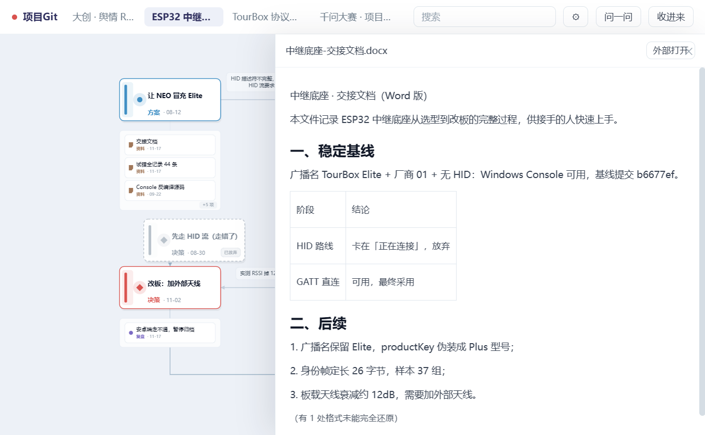
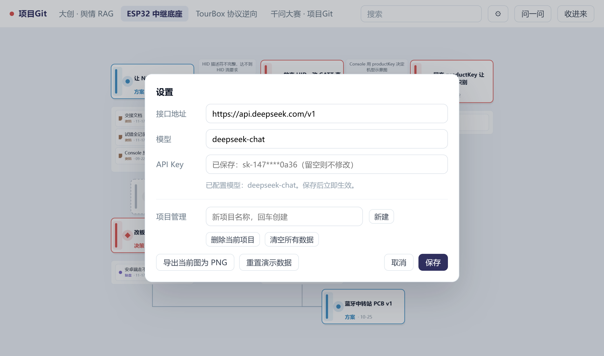

# 项目Git · 使用说明

面向第一次打开这个软件的人，照着做，5 分钟能上手。

## 1. 这是什么

项目Git 把散落在聊天记录、文档和代码里的决定、方案、复盘，整理成一张 Git 式提交图：每张卡片是一次提交，主干是决策链，分叉记录尝试过的路。走错的路不会被删掉，而是标成终止分支留在图上。你可以直接问「为什么当初这么定」，回答带原文出处，点引用就能跳到原文。内置演示库含 4 个真实项目，共 56 个节点、65 条关系、23 份原文。



*图：数据写入 `data/state.json`，桌面端直接读文件渲染，无服务器、无端口。*

## 2. 安装与启动

两种方式任选：

1. 命令行启动：

   ```bash
   cd desktop
   npm start
   ```

2. 双击桌面「项目Git」快捷方式。

首次启动约 1~2 秒。桌面端基于 Electron 45，卡片用 Canvas 自绘。



*图：启动后即进入主视图，中间是提交图画布，右侧是详情面板。*

## 3. 界面速览



*图：顶栏、画布、右侧详情面板三块区域。*

| 区域 | 位置 | 作用 |
|---|---|---|
| 顶栏 | 顶部 | 项目切换 / 搜索 / ⚙设置 / 问一问 / 收进来 |
| 画布 | 中间 | 提交图，卡片与连线都在这里 |
| 详情面板 | 右侧 | 选中卡片的简介、联系与出处 |

## 4. 看懂这张图


*图：主干是决策链；带 × 的分叉是终止的尝试；两条线汇合表示被采纳。*

| 图上元素 | 含义 |
|---|---|
| 卡片 | 一条提交 |
| 左色条 + 类型名 | 类型：决策 / 方案 / 复盘 / 资料 / 数据 / 代码 / 产出 |
| 主干 | 决策链 |
| 分叉 | 一次尝试 |
| × | 终止的尝试，走错的路不会被删掉 |
| 两条线汇合 | 该尝试被采纳 |
| 右下小旗 | tag 里程碑 |
| 卡片下方 | 这次提交带的材料 |
| 两卡之间的小字 | 「怎么走到下一步」 |

布局由确定性计算生成：三列折行 + 蛇形 + 分支泳道。演示库四个项目的规模：

| 项目 | 节点数 |
|---|---|
| 北极星 · 客服工单分流 | 12 |
| 山海 · 边缘告警 | 11 |
| 潮汐 · 内容审核台 | 9 |

## 5. 问一个问题



*图：回答按结论 / 依据 / 之前 / 后来 / 放弃的尝试 / 相关组织，末尾是引用 chip。*

1. 点顶栏「问一问」。
2. 输入：`为什么放弃微调小模型？现在还有效吗？`
3. 得到按 结论 / 依据 / 之前 / 后来 / 放弃的尝试 / 相关 组织的回答，附引用 chip。
4. 点引用 chip 进原文；点「在图上看」定位到对应节点。

未配 Key 时由本地规划器作答；配 Key 后走模型，见第 8 节。

## 6. 看原文

详情面板分三段：

| 段 | 内容 |
|---|---|
| 简介 | 这条提交讲了什么 |
| 与上下节点的联系 | 上游怎么来、下游往哪去 |
| 出处 | 原文文件路径与片段 |



*图：出处里的路径可点击，会在文件管理器中选中该文件。*

点「在应用内打开」可直接预览：

| 格式 | 预览方式 |
|---|---|
| Markdown | 渲染并高亮命中句 |
| 文本 / 代码 | 直接显示 |
| 图片 | 直接显示 |
| PDF | 独立窗口，可翻页 |
| Word | 渲染表格与列表 |



*图：Word 原文在应用内渲染，表格与列表保留。*

演示库中 15 个资料·数据·代码类条目全部有真实原文，缺文件 0。没有 `source` 的条目，详情会显示「无原文」。

## 7. 导入一个项目

1. 先预演，只看统计不写盘：

   ```bash
   node tools/ingest.js examples/batch-example.json --dry-run
   ```

2. 统计与警告没问题，去掉 `--dry-run` 正式导入：

   ```bash
   node tools/ingest.js examples/batch-example.json
   ```

最小 JSON 示例：

```json
{
  "project": { "id": "p_demo", "name": "示例 · 课程设计" },
  "nodes": [
    {
      "title": "先做单机版验证想法",
      "type": "方案",
      "date": "2026-03-02",
      "status": "有效",
      "branch": "main",
      "parents": [],
      "source": { "file": "冲突用例.md" }
    }
  ]
}
```

字段规则：`title` 必填，其余可选；`parents` 支持批内 key、真实 id 或标题；同项目 + 同标题 + 同日期的条目重复导入会被跳过。要把一条尝试画成终止分支，须写 `status: "已放弃"` 并给非 main 的 `branch`（如 `feat/hid`），图上才会出现带 × 的分叉。导入会标准化、去重，落盘前自动备份。


*图：JSON 经标准化、去重写入 `data/state.json`，切到该项目即见图。*

## 8. 接入模型



*图：⚙ 设置里填接口地址、模型、API Key，保存即生效。*

1. 点顶栏 ⚙，填接口地址 / 模型 / API Key，保存即生效。
2. 也可以直接写 `data/qa_config.json`，或设环境变量 `PG_QA_API_KEY`。

有 Key 时走模型（OpenAI 兼容接口，最多 6 轮工具调用）；问答工具共 5 个：`list_projects` / `search` / `get_node` / `get_timeline` / `get_citations`。**Key 无效或断网会自动回落本地规划器**，不影响使用。设置里还可「导出当前图为 PNG」「重置演示数据」。

## 9. 自检命令

愿意验证的话，仓库自带四条自检（问答评估均为无模型时的本地规划器结果）：

```bash
python tools/check_sources.py
node tools/check_layout.js
node tools/eval_qa.js
node tools/eval_hard.js
```

| 命令 | 检查什么 | 当前结果 |
|---|---|---|
| `check_sources.py` | 原文文件是否齐全 | 15 个资料·数据·代码条目全有原文，缺文件 0 |
| `check_layout.js` | 卡片是否重叠 | 4 个项目 0 重叠 |
| `eval_qa.js` | 简单问答 20 题（本地规划器） | 17/20（85%） |
| `eval_hard.js` | 全部换说法 20 题 | 10/20（50%）：事实 3/6、状态 4/6、跨项目 1/5、溯源 2/3 |


*图：布局自检确认 4 个项目卡片 0 重叠。*

## 10. 已知边界

- 单用户，无权限体系。
- xlsx 只能外部打开，不在应用内预览。
- PDF 是独立窗口，不是内嵌。
- git 只读单仓库。
- 模型需要自己配 Key；无 Key 时走本地规划器。


*图：出处与预览能力以详情面板为准，格式限制见上。*

> 文档版本 v1.0 · 与程序同仓，改动请同步 docs/README.md
